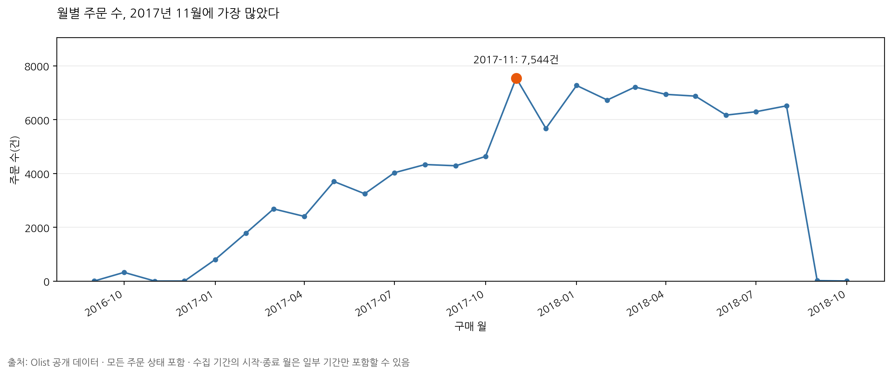
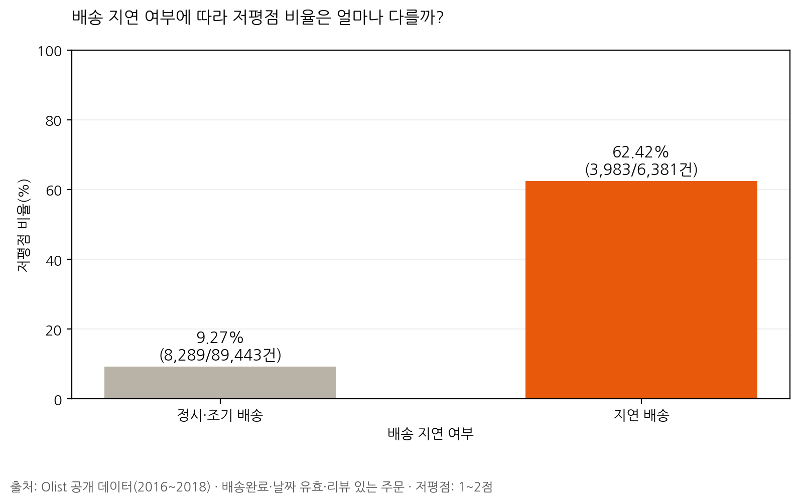
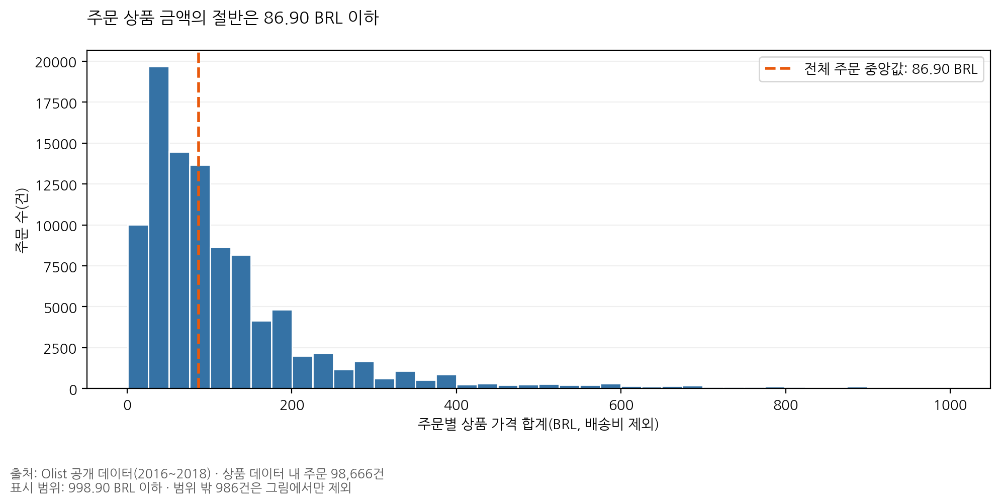

# Olist 주문 데이터 시각화 및 추가 분석

## 실습 목적
Olist 주문 데이터를 활용해 월별 주문 추이, 배송 지연과 저평점의 관계, 주문 상품 금액 분포를 분석했다.

## 분석 질문과 결과

### 1. 주문 수는 월별로 어떻게 변했을까?
모든 주문 상태를 포함해 집계한 결과, 2017년 11월의 주문 수가 7,544건으로 가장 많았다.

### 2. 배송이 늦은 주문에서 저평점 비율이 높을까?
배송완료·날짜 유효·리뷰 있는 주문을 분석한 결과, 지연 배송의 저평점 비율은 62.42%로 정시·조기 배송의 9.27%보다 높았다. 이는 관찰된 관계이며 인과관계를 증명하지 않는다.

### 3. 주문 상품 금액은 어느 구간에 몰려 있을까?
상품 데이터에 있는 주문 98,666건의 상품 가격 합계 중앙값은 86.90 BRL이었다. 배송비는 제외했으며, 998.90 BRL를 초과하는 986건은 그림에서만 제외했다.

## 사용한 분석 방법
- 결측치·중복 확인 및 날짜 변환
- 구매 월별 고유 주문 수 집계
- 주문별 마지막 응답 리뷰 선택
- 배송 지연 여부별 저평점(1~2점) 비율 비교
- 주문별 상품 금액 합산 및 중앙값·99백분위 분석

## 실행 방법
`Olist_시각화_추가분석.ipynb`를 Google Colab에서 열고 위에서부터 순서대로 실행한다. 데이터는 원본 GitHub 저장소에서 불러오며 차트는 `images` 폴더에 저장된다.

## 데이터 출처
[Olist 원본 분석 저장소](https://github.com/journal-izm/Olist-Data-Analysis)

## AI 활용
ChatGPT의 도움으로 분석 코드와 설명 초안을 작성하고, Colab 실행 결과의 집계 수치를 확인했다.
